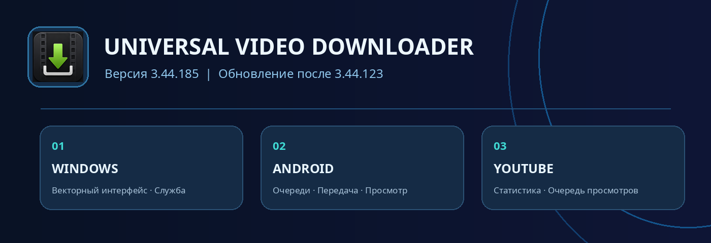
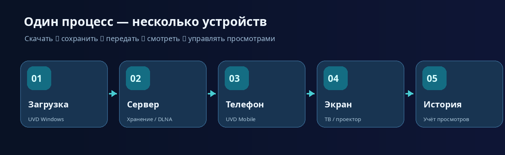



## ✨ Главное в обновлении

В релизе **3.44.185** улучшены загрузка видео, работа UVD Mobile, интеграция с браузером, управление сервером Windows и отдельная очередь просмотров для статистики YouTube.

| Область | Что нового |
| --- | --- |
| 📥 Загрузка | aria2c, несколько соединений, прогресс и качество |
| 📱 Android | очередь загрузок на телефон, отмена, свайпы, превью |
| ▶️ YouTube | очередь просмотра для статистики, автоматизация |
| 🖥️ Windows | векторные иконки, перевод, управление службой |
| 🌐 Браузер | улучшенное расширение UVD Browser Integration |

## 📥 Загрузка видео и управление файлами

- Поддержана **многопоточная загрузка одного файла через aria2c** с настройкой количества соединений.
- Улучшен анализ прогресса, скорости скачивания и оставшегося времени.
- Качество, выбранное при отправке ссылки с телефона, имеет приоритет перед стандартным качеством Windows-приложения.
- Улучшены повторная загрузка, синхронизация заданий и обработка ошибок передачи.

## ▶️ Просмотр для статистики YouTube

- Добавлен автоматизированный **«Просмотр для статистики»** во встроенном браузере.
- Можно задавать скорость и качество воспроизведения, а также просматривать видео без звука.
- Создана **отдельная очередь просмотров**, не зависящая от очереди скачивания и наличия локального файла.
- Добавлены состояния **«Ожидает», «Просматривается», «Просмотрено», «Ошибка»** и цветовая индикация.
- Доступны ручное добавление ссылок, повторное воспроизведение и отметка «Просмотрено».
- Улучшены определение конца ролика, переход к следующему заданию и обработка зависаний.
- При доступности стандартной кнопки YouTube «Пропустить» система пытается нажать её автоматически.

> **Примечание:** воспроизведение видео не гарантирует зачёт просмотра или изменение рекомендаций на стороне YouTube — это определяется правилами платформы.

## 📱 UVD Mobile для Android

- Возможность **скачать на телефон после завершения загрузки на сервер** с сохранением отложенных задач.
- Улучшено обновление очередей и прогресса, в том числе при потере связи с сервером.
- Исправлены зависания свайпов и команд при одновременных загрузках.
- Доработаны действия «Остановить», «Удалить с телефона», «Удалить с сервера» и «Удалить с обоих устройств».
- Ожидающую передачу можно отменить сразу; при активной передаче отображается «Останавливается…».
- Сохранены локальные миниатюры, чтобы они оставались видимыми при отсутствии соединения.
- Обновлены цвета строк в соответствии с местонахождением файла и состоянием загрузки.
- Подпись готового серверного файла стала понятнее: **«На сервере · 100%»**.
- Добавлены отметки просмотра на смартфоне и синхронизация статусов с другими устройствами (в тестовом режиме)
- Улучшено управление скоростью воспроизведения и перемоткой касаниями.
- Доработана работа фонового плеера и режима Picture-in-Picture.

## 🌐 Расширение браузера

- Обновлено **UVD Browser Integration до 1.0.21**.
- Улучшены контекстные команды UVD на YouTube, включая отображение в светлой теме.
- Усовершенствована передача ссылки в запущенное приложение и запуск UVD при необходимости.
- Исправлены отдельные проблемы с языковыми подписями и подсветкой меню.

## 🖥️ Windows: интерфейс и локальный сервер

- Шрифтовые значки заменены на **встроенные векторные иконки**, не требующие специальных шрифтов Windows.
- Улучшены локализация RU/EN и отображение динамических надписей в настройках.
- Доработано управление сервером, работающим как служба Windows.

---

**📦 Диапазон обновлений:** `3.44.124–3.44.185` · **💻 Windows:** `3.44.185` · **📱 Android:** `1.1.185`