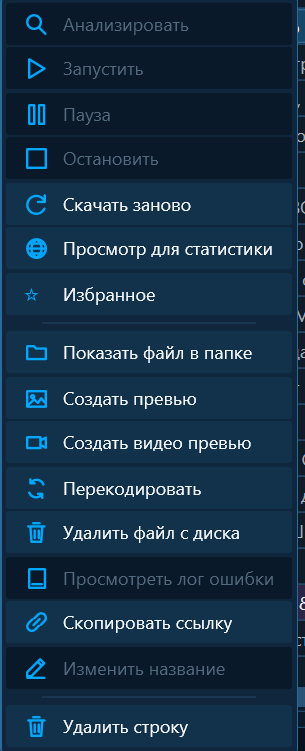
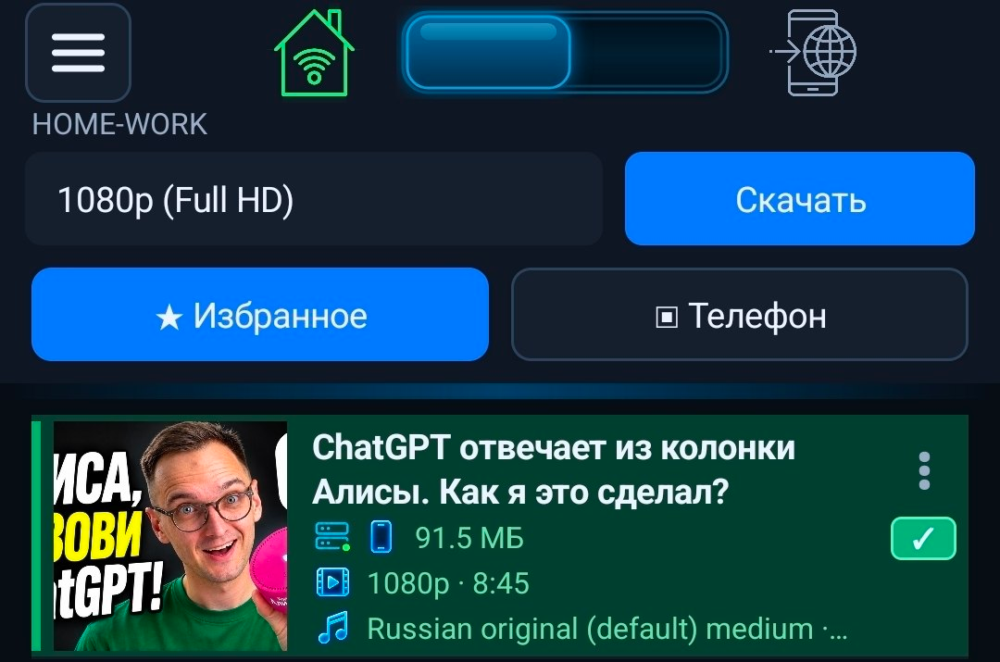
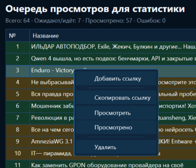
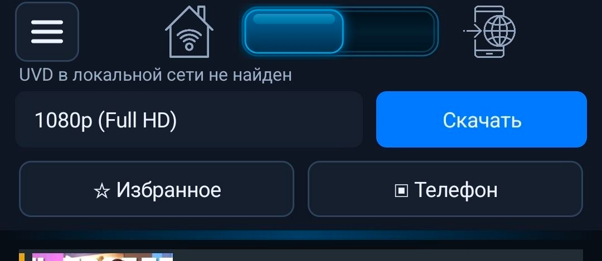
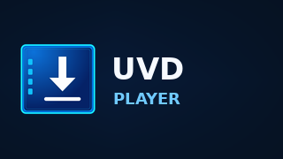
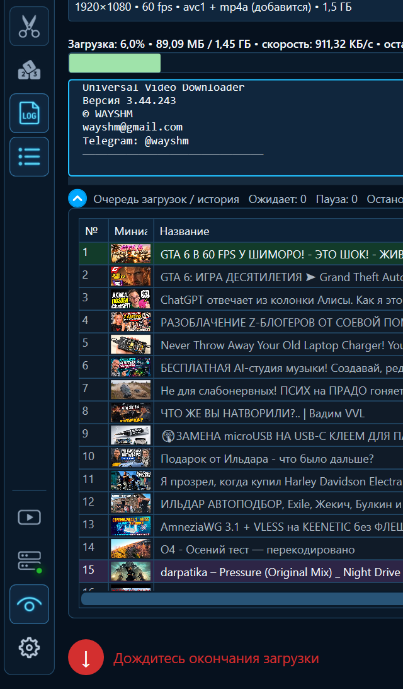

**Большое обновление Windows, Android, Android TV и браузерной интеграции**  
**Период изменений: v3.44.186 → v3.44.27**

> 🆕 Единое «Избранное», продолжение просмотра на разных устройствах, быстрый доступ к видео на телефоне, улучшенный встроенный плеер и более надёжная работа серверов и браузера.

---

## ⭐ Избранное — одно для всех устройств

Добавлена **синхронизация избранных видео между Windows UVD, смартфоном, автомобильной магнитолой, телевизором и проектором**. Отмечайте ролик на одном устройстве — после подключения отметка становится доступна и на остальных.

- В Windows появилась **кнопка со звездой** в левой панели: она включает и выключает фильтр избранных записей.
- В контекстном меню очереди загрузок и очереди просмотров появилась команда **«Избранное»**.
- На Android в меню **⋮** карточки можно добавлять в избранное и удалять из него; кнопка **«Избранное»** фильтрует привычные карточки прямо в «Загрузках», без перехода в Библиотеку.
- Изменения сохраняются локально при отсутствии сети; при подключении синхронизируются и добавления, и снятия отметок.
- Список избранного хранится независимо от истории загрузок.

*Иллюстрация: команда «Избранное» в меню очереди загрузок Windows.*

*Иллюстрация: активное «Избранное» и обычные карточки загрузок в мобильном UVD.*

## ▶️ Очередь просмотров для статистики

Обновлён инструмент последовательного просмотра ссылок.

- Команда **«Запустить»** открывает встроенный браузер и проигрывает **именно выделенные строки** последовательно, в порядке списка.
- Для множественного выбора используется привычное выделение **Ctrl/Shift** — то же, что для команды «Просмотрено».
- Не выделенные пользователем строки не запускаются; повторный просмотр ранее завершённого ролика начинается с начала.
- Сохранены действия «Просмотреть», «Просмотрено», удаление, история и обработка неудачных просмотров.

## 📱 Мобильный UVD: быстрый доступ без лишних переходов

Верхняя панель стала **трёхпозиционной**: полностью свёрнута, открыт основной переключатель, открыта зона быстрого доступа. Голубая полоса получила увеличенную невидимую область захвата и более отзывчивые жесты.

- **«Избранное»** оставляет пользователя в «Загрузках» и показывает только отмеченные карточки. Повторное нажатие возвращает общий список.
- **Кнопка выбранной папки** (например, «Телефон») показывает видео из назначенного каталога **в том же интерфейсе «Загрузок»**. Повторное нажатие снимает фильтр.
- **Долгое нажатие** на кнопку папки позволяет выбрать другую папку из Библиотеки, включая вложенные.
- Для каталога телефона на магнитоле исправлена сортировка: новые файлы идут первыми; поддержаны ранее скачанные видео и дополнительные форматы.
- Карточки передают на магнитолу качество, размер, хронометраж и доступные сведения об аудиодорожке.

## 🔄 Продолжение просмотра на другом устройстве

**Позиция воспроизведения синхронизируется** между встроенными плеерами UVD на телефоне, магнитоле, телевизоре и проекторе через подключённый UVD-сервер или сервер телефона.

- Позиция и момент последнего обновления сохраняются между запусками.
- При новом открытии того же видео используется наиболее свежая доступная позиция.
- После полного завершения фильма следующий просмотр начинается с начала.
- При временном отсутствии сети локальная позиция не теряется и передаётся при восстановлении связи.

> ℹ️ Для синхронизации устройства должны иметь связь с одним UVD-сервером или подключённым к нему сервером телефона. Сторонние плееры не всегда передают UVD свою позицию.

## 🎬 UVD Player для Android TV, проектора и магнитолы

- На автомобильных экранах добавлен режим **крупных кнопок плеера ×3** с увеличенными областями нажатия; его можно включить вручную в настройках.
- Увеличены элементы управления скоростью и кнопка плавающего окна (PiP); исправлены наложение подписей на стрелки и скачки боковых кнопок при скрытии панели.
- Боковые кнопки теперь исчезают вместе с центральной панелью управления.
- Во время просмотра на ТВ/проекторе UVD удерживает экран активным, чтобы системная заставка не запускалась по обычному тайм-ауту; при паузе и остановке удержание снимается.
- На телефоне плеер закрывает чёрное полноэкранное окно после завершения видео при выключенном экране.
- Обновлено оформление значка **UVD Player** для ТВ.

> ⚠️ На отдельных проекторах собственная заставка прошивки может игнорировать стандартные механизмы Android — это зависит от устройства.

## 🖥️ Windows: интерфейс и надёжность

- **Левая панель:** единая индикация Active/Inactive/Hover, мягкое голубое свечение активных иконок в тёмной теме и чёрные активные иконки в светлой.
- **«Настройки»:** кнопка-шестерёнка показывает фактическое состояние окна, открывает и закрывает его повторным нажатием. Выправлена геометрия самой иконки.
- **Log:** исправлена вертикальная прокрутка больших журналов — ползунок не превращается в обрезок при накоплении строк.
- **Загрузка:** анимированный индикатор ожидания встроен непосредственно в EXE, без зависимости от внешней папки с кадрами.
- Улучшена передача сервером метаданных выбранного качества, включая оценку размера **≈**, фактический размер и длительность.

## 🌐 Сервер, удалённый доступ и Browser Integration

- В настройках удалённого доступа добавлено управление совместным запуском локального сервера, **UVD Remote Service** и Remote Agent из контекстного меню кнопки сервера.
- Улучшено восстановление Remote Service после перезапуска Windows при соответствующих настройках автозапуска.
- **Browser Integration:** при недоступном локальном HTTP-канале добавлен резервный способ передачи ссылки через `uvd://send`, без повторного запуска уже открытого UVD.
- Обновлён механизм обработки локальных запросов браузера и повторного запуска интеграционного сервера после сбоя.
- Для Chrome и Edge расширение позволяет по явной команде пользователя экспортировать cookies YouTube в совместимый с UVD файл `cookies.txt`, не отключая защиту браузера.

> 🔐 **Безопасность:** файл `cookies.txt` содержит данные авторизации. Не публикуйте его и удалите экспортированный файл после импорта.

---

## 🛠️ Техническая информация

| Компонент | Версия / параметры |
|---|---|
| **Windows UVD** | **3.44.271**, Windows x64, .NET 10, framework-dependent |
| **Android UVD Mobile / Player** | **1.1.267**, `versionCode 268` |
| **Browser Integration** | **1.0.23** |
| **Сборка Windows** | `build.bat` → `build-optimized.bat` |
| **Сборка Android** | `build-remote-android.bat`, постоянный release signing key |
| **Обновление Android** | Поверх прежней версии; не удаляйте приложение и не заменяйте ключ подписи |

**Примечания:** описание объединяет ключевые изменения в диапазоне **после 3.44.186 до 3.44.271**; не все мелкие исправления перечислены. Доступность отдельных функций зависит от настроенного сервера, версии клиента и разрешений Android. Указанные изменения реализованы в исходниках; некоторые сценарии требуют проверки на реальных устройствах.

**Universal Video Downloader — один медиакаталог и единый привычный интерфейс на Windows, телефоне, магнитоле и большом экране.**